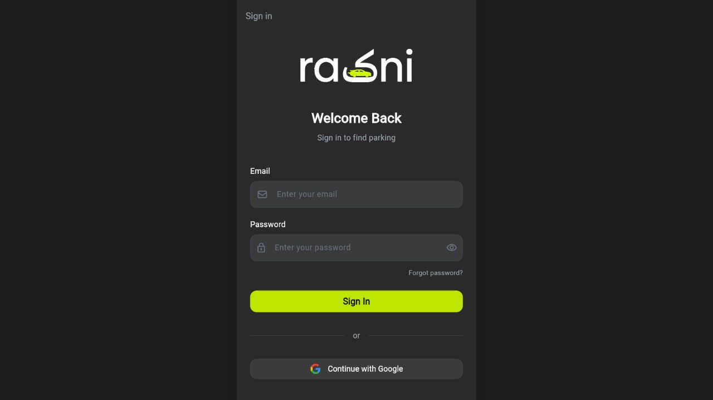
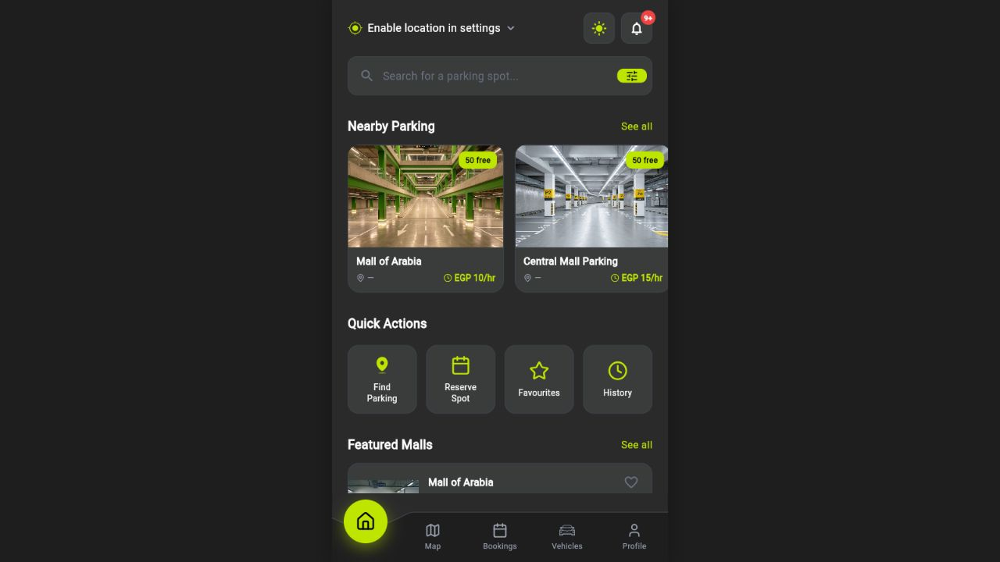
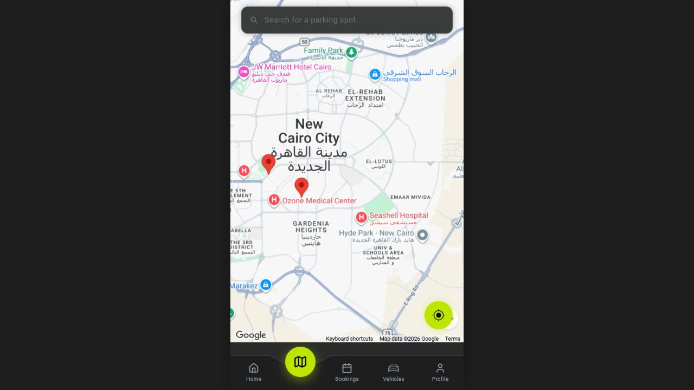
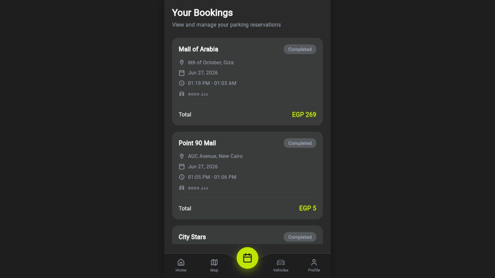

# Rakni

Rakni is an AI-powered smart parking platform that helps drivers discover nearby parking, reserve a spot, manage active sessions, pay through a wallet flow, and receive booking notifications. The project also includes the foundations for parking-operator workflows such as real-time availability, slot management, pricing rules, plate verification, gate operations, and operational reporting.

The app is built as a Flutter mobile-first experience with a Firebase backend, Cloud Firestore data model, Cloud Functions for account flows and notifications, Google Maps integration, and a deployed Flutter Web preview.

## Live Demo

- Web app: [https://rakni-v2-web.vercel.app](https://rakni-v2-web.vercel.app)
- Repository: [https://github.com/abdelrahman-abozarifa04/rakni_v2](https://github.com/abdelrahman-abozarifa04/rakni_v2)

## Screenshots

<p>
  
  
  
</p>

<p>
  
  
</p>

## Core Features

- Secure driver authentication with Firebase Auth, email/password login, Google sign-in support, OTP verification, and password recovery.
- Parking discovery with nearby lots, search, filters, availability counts, prices, ratings, and favourites.
- Google Maps parking view with lot markers and location-aware navigation entry points.
- Reservation flow for selecting a parking lot, vehicle, time range, slot type, and parking spot.
- Booking lifecycle management for pending, active, completed, and cancelled reservations.
- Wallet and transaction history flows for parking payments and top-ups.
- Vehicle management with linked license plate details for recognition and booking validation.
- Notifications for booking, payment, and parking activity updates.
- Admin and operations foundations for occupancy monitoring, pricing changes, gate overrides, and manual plate review.
- Bilingual-ready Flutter structure with English and Arabic Egypt localization support.

## Why Rakni Matters

Parking in dense cities creates wasted time, traffic congestion, unclear availability, and manual gate friction. Rakni turns parking into a connected workflow: drivers can find and reserve spaces before arrival, operators can track live occupancy, and the system can connect vehicle identity, booking state, payment records, and gate actions in one auditable data model.

This repository is useful as a complete reference implementation for students, municipalities, parking operators, and developers building smart-city or mobility products. It demonstrates how a real parking ecosystem can be assembled from open technologies: Flutter, Firebase Auth, Cloud Firestore, Cloud Functions, Google Maps, push notifications, wallet transactions, and license-plate-oriented workflows.

## Architecture

```text
Flutter app
  |-- Auth, profile, booking, wallet, map, notification, and admin-facing screens
  |-- Shared models, services, repositories, localization, and theme utilities
  |-- Web shell for a mobile-width deployed preview

Firebase
  |-- Authentication for account and session management
  |-- Cloud Firestore for users, vehicles, lots, slots, bookings, wallets, transactions, reviews, and notifications
  |-- Cloud Functions for OTP email, verification links, password reset, and FCM notification triggers
  |-- Firebase Hosting support for production web deployment

Integrations
  |-- Google Maps for lot discovery and route context
  |-- Firebase Messaging and local notifications
  |-- Resend-backed transactional email templates
  |-- Parking hardware API abstraction for gate and slot workflows
```

## Tech Stack

| Layer | Technology |
| --- | --- |
| Client | Flutter, Dart, Material 3 |
| Web deployment | Flutter Web, Vercel, Firebase Hosting support |
| Authentication | Firebase Auth, Google Sign-In |
| Database | Cloud Firestore |
| Backend automation | Firebase Cloud Functions, TypeScript |
| Maps and location | Google Maps Flutter, Geolocator, Geocoding |
| Notifications | Firebase Messaging, Flutter Local Notifications |
| Payments model | Wallet and transaction collections in Firestore |
| Quality | Flutter tests, analyzer config, TestSprite scenario suite |

## Repository Structure

```text
lib/
  core/
    models/              Shared domain models
    repositories/        Data access abstractions
    services/            Auth, Firestore, booking, notifications, theme, OCR, hardware API
    theme/               App color system
    localization/        Locale and string support
  features/
    auth/                Sign in, account creation, verification, reset password
    home/                Parking search, favourites, lot details
    map/                 Parking map
    booking/             Reservation, active session, gate scans, payment details
    bookings/            Booking history and receipts
    wallet/              Wallet balance and top-up
    profile/             Profile, vehicles, settings, subscriptions
    notifications/       In-app notifications

functions/
  src/index.ts           Firebase Cloud Functions for email, OTP, reset, and FCM

scripts/
  seed_parking_lots.js   Firestore seed data for parking lots and slots

testsprite_tests/
  TC001-TC030            End-to-end product test scenarios and generated reports

docs/screenshots/
  *.png                  README screenshots captured from the live deployment
```

## Data Model

Rakni uses Firestore collections that map directly to the parking domain:

- `users` with a nested `vehicles` subcollection.
- `parkingLots` with a nested `slots` subcollection.
- `bookings` for reservations and parking-session state.
- `wallets` and `transactions` for payment history.
- `notifications` for user-facing booking and payment updates.
- `reviews` for parking-lot feedback.
- `otps` for short-lived verification and password-reset codes managed by Cloud Functions.

See [FIRESTORE_STRUCTURE.md](FIRESTORE_STRUCTURE.md) for the detailed schema.

## Getting Started

### Prerequisites

- Flutter SDK compatible with Dart `^3.11.0`
- Firebase CLI
- Node.js for Firebase Functions and seed scripts
- A Firebase project with Auth, Firestore, Functions, Messaging, and Hosting configured
- Google Maps API key
- Optional Resend API key for transactional email delivery

### Install

```bash
flutter pub get
cd functions
npm install
cd ..
```

### Environment

The web build script reads these values from the environment:

```bash
MAPS_API_KEY=your_google_maps_key
GEMINI_API_KEY=your_gemini_key_if_used
PARKING_API_BASE_URL=your_parking_hardware_api_url
PARKING_API_TOKEN=your_parking_hardware_api_token
```

Firebase Functions also expect email configuration:

```bash
firebase functions:secrets:set RESEND_API_KEY
```

Optional function environment values:

```bash
RESEND_FROM_EMAIL=noreply@your-domain.com
RESEND_FROM_NAME=Rakni
AUTH_ACTION_HANDLER_URL=https://your-hosted-app-url
```

### Run Locally

```bash
flutter run
```

For Flutter Web:

```bash
flutter run -d chrome --dart-define=MAPS_API_KEY=$MAPS_API_KEY
```

### Seed Parking Lots

Place a Firebase Admin service account file at `scripts/serviceAccountKey.json`, then run:

```bash
cd scripts
npm install
node seed_parking_lots.js
```

## Testing

Run Flutter tests:

```bash
flutter test
```

Run static analysis:

```bash
flutter analyze
```

The `testsprite_tests/` directory documents 30 product scenarios covering authentication, parking discovery, booking, payment, active sessions, notifications, admin operations, and history/receipt workflows.

## Deployment

Build Flutter Web:

```bash
flutter build web \
  --dart-define=MAPS_API_KEY=$MAPS_API_KEY \
  --dart-define=GEMINI_API_KEY=$GEMINI_API_KEY \
  --dart-define=PARKING_API_BASE_URL=$PARKING_API_BASE_URL \
  --dart-define=PARKING_API_TOKEN=$PARKING_API_TOKEN \
  --release
```

Deploy Firebase hosting with the helper script:

```bash
./build_web.sh
```

The repository also includes Vercel configuration for the public web preview.

## Open Source and Ecosystem Impact

Rakni is more than a parking UI. It is a full smart-parking ecosystem prototype that connects driver experience, parking-lot operations, booking state, payment records, notifications, and vehicle identity workflows. This makes it useful for developers studying smart-city applications, university teams building mobility projects, and maintainers who need a realistic Firebase/Flutter reference app with non-trivial domain logic.

The project can help downstream builders learn how to:

- Model real-time parking availability and slot inventory.
- Coordinate reservations, wallet transactions, and booking status changes.
- Design mobile-first parking flows with web deployment support.
- Combine Firebase Auth, Firestore security rules, Functions, FCM, and Maps in one application.
- Extend a student prototype toward IoT gate control, license plate recognition, and operator dashboards.

## Roadmap

- Harden Firestore security rules around bookings, transactions, and admin-only operations.
- Add a production admin dashboard for lot operators.
- Improve automated tests around booking conflict prevention and wallet balance updates.
- Add CI for `flutter analyze`, `flutter test`, and Firebase Functions checks.
- Publish a clear open-source license before external production reuse.

## Claude for Open Source Application Summary

For an Ecosystem Impact Track application, describe Rakni honestly as a public smart-parking ecosystem project rather than claiming large repository metrics. A concise application statement:

```text
I maintain Rakni, a public Flutter and Firebase smart-parking ecosystem that demonstrates how drivers, parking operators, booking workflows, payments, notifications, maps, and vehicle identity can work together in one open implementation. The project includes a live web deployment, mobile-first Flutter app, Firebase Auth, Cloud Firestore schema, Cloud Functions for OTP/password reset/FCM notifications, Google Maps integration, wallet and transaction flows, booking lifecycle logic, vehicle management, and documented end-to-end scenarios.

Rakni is designed as a practical reference for students, smart-city developers, and parking-technology builders who need a complete example beyond a simple CRUD app. It shows how to model parking lots, slots, reservations, users, vehicles, wallets, notifications, reviews, and operational workflows in a real codebase. I am the primary maintainer and continue improving the project, documentation, tests, and deployment so others can learn from it or adapt it for mobility and smart-city prototypes.

Although the repository does not meet the high-star Maintainer Track threshold, its ecosystem value is educational and architectural: it connects multiple open technologies into a realistic urban mobility system and provides reusable patterns for Flutter/Firebase applications with maps, payments, notifications, and IoT-ready parking operations.
```

## License

No license file is currently included. Add a license before treating the project as reusable open-source software outside this repository.
